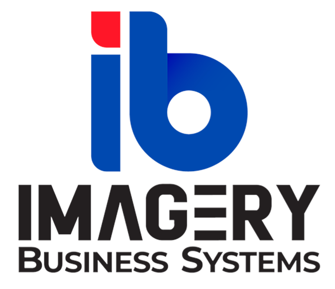
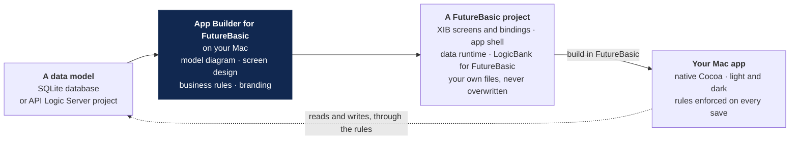

<p align="center"></p>

<p align="center"><sub>IMAGERY BUSINESS SYSTEMS · FOR THE FUTUREBASIC COMMUNITY</sub></p>

# App Builder for FutureBasic

**Point it at a database. Get a native Mac app in FutureBasic, with its screens, its data access
and its business rules written for you, in code you can read and keep.**

## What it is

An app builder that runs on your Mac. It reads a data model, either the tables, keys and
relationships of a SQLite database or the model of an API Logic Server project, and writes a
complete FutureBasic project for it. You open that project in FutureBasic, build it, and carry on
from there like any other FB program.

What sets it apart is the rules engine inside every app it makes. Totals, formulas, checks and
what happens on delete are declared once, and the engine enforces them on every save, in one
transaction, whichever screen or code made the change.

## The big picture



The app works on the same database, and every save passes through the rules engine in one
transaction. Change the model or the rules in App Builder, then generate again; your own code stays.

Also as a designed page and a PDF to share: [`DOC_ONE_PAGER.html`](DOC_ONE_PAGER.html),
[`DOC_ONE_PAGER.pdf`](DOC_ONE_PAGER.pdf).

## How it works

1. **Open a model.** Choose a SQLite file, or point at an API Logic Server project (its folder,
   its model file, or its GitHub repository). App Builder reads every table, column, key and
   relationship, and draws the model as an interactive diagram.
2. **Shape the app.** Review each entity's fields, adjust titles and widths, import or write the
   business rules, and add your logo, tag-line and copyright.
3. **Generate and build.** Generate App writes a FutureBasic project: screens, bindings, the data
   runtime, the rules engine and a start-up program. Open it in FB and build.

## What the generated app has

| | |
|---|---|
| **A common look** | A dark blue navigation bar with an icon per entity, a header with your logo, app name, tag-line, theme menu and Log In, and a footer. Light and dark mode come for free. |
| **Grid or tiles** | Each List shows its records as a grid, or as tiles three or four across, with the record's name as a heading and its details underneath. |
| **Screens as XIBs** | A List and a Form for every entity, loaded with FB's own `nibview`. Open any of them in Xcode's Interface Builder and change it. |
| **Data, done properly** | Reads and writes the SQLite database through Imagery's SQL Generator: parameterized queries, joins, parent and child lookups and real transactions. |
| **LogicBank for FutureBasic** | The rules engine: formulas, sums, counts, copies, constraints, parent checks, delete actions and events, run in dependency order on every save. |
| **Code people can read** | Every file says what it does and whether it is regenerated. A `README.md` walks you through the project, file by file. |
| **A map of the model** | App Builder's model diagram shows every entity and relationship with the rules marked where they act. Drag, fold, search, export to SVG. |

## Rules, declared once

```
// a line's amount
fn LogicFormula( @"OrderDetail", @"Amount",
  @fn OrderDetailAmount,
  @[ @"Quantity", @"UnitPrice" ] )

// an order's total, a customer's balance
fn LogicSum( @"Order", @"AmountTotal",
  @"OrderDetailList", @"Amount", NULL )
fn LogicSum( @"Customer", @"Balance",
  @"OrderList", @"AmountTotal",
  @fn OrderIsUnshipped )

// and the check that guards them
fn LogicConstraint( @"Customer",
  @fn CustomerCreditCheck,
  @"Balance {Balance} exceeds {CreditLimit}" )

// a screen saves one thing; the engine
// does the rest, or refuses all of it
if ( fn LogicInsert( @"OrderDetail", newLine ) == NO )
  alert 1, NSAlertStyleWarning, fn LogicMessage,
    @"", @[@"OK"], NO
end if
```

What one save does:

| | | |
|---|---|---|
| ƒ | `OrderDetail.Amount` | Quantity × UnitPrice, for the new line |
| ↓ adjusts | | |
| Σ | `Order.AmountTotal` | adds the line's amount, without recounting |
| ↓ adjusts | | |
| Σ | `Customer.Balance` | for unshipped orders only |
| ↓ checks | | |
| ✓ | `Balance ≤ CreditLimit` | if not, the whole save is rolled back and the message says why |

Rule kinds: ƒ formula · Σ sum · # count · ⇣ copy · ✓ constraint · ⊘ delete action · ⚡ event

## The SQL Generator

Every read and write in a generated app goes through Imagery's SQL Generator, a query builder
written in FutureBasic. You describe the statement: its tables, columns, joins and filters. It
writes the SQL, with every value sent separately from it.

```
// describe the query: tables, columns,
// the join and a filter
query = fn InitQueryDictionary
fn AddTableToQuery( query, @"Order", @"o" )
fn AddTableToQuery( query, @"Customer", @"c" )
fn AddColumnToQuery( query, @"o.Id", @"Order" )
fn AddColumnToQuery( query, @"c.CompanyName", @"Company" )
fn AddAssociationToQuery( query,
  @"o", @"CustomerId", @"c", @"Id", _isEqual )
fn AddFilterToQuery( query, @"c", @"Country",
  @"Germany", _textType, NULL, _isEqual, NULL )

// the SQL, then run it with its values
sql = fn GenerateSelectSQL( query )
fn DataExecute( sql,
  fn QueryParameterValues( query ), rows )
```

The SQL it writes:

```sql
SELECT "o"."Id" AS "Order",
       "c"."CompanyName" AS "Company"
  FROM "Order" AS "o", "Customer" AS "c"
 WHERE "o"."CustomerId" = "c"."Id"
   AND "c"."Country" = ?
-- values: Germany
```

- **SELECT, INSERT, UPDATE and DELETE** from one builder; joins, and filters (comparisons, IN,
  LIKE, IS NULL) joined by AND or OR.
- **Parameterized.** Values are bound to `?` placeholders, never pasted into the SQL: no SQL
  injection, no quoting bugs.
- **Names quoted.** Tables called `Order` or `Group`, and columns with spaces, just work.
- **Safe by default.** UPDATE and DELETE refuse to run without a filter, so a whole table is
  never changed by accident.

## The app stays yours

- **Written once, then yours:** `EventHandlers.incl`, `Windows.incl`, `Menus.incl`, `Theme.incl`
  and `Rules.incl`. Regenerating never touches them. Delete one to get a fresh copy.
- **Regenerated from the model:** screens, bindings, pages, the runtime and the start-up program.
  Change the model, your adjustments or the rules in App Builder, and generate again.

## At a glance

| You need | Editions | Where it stands |
|---|---|---|
| A Mac with FutureBasic 7 | **Lite**, free with registration: apps on your Mac, from a SQLite database | Generated apps build and run on the Mac |
| Xcode's command-line tools (FB needs them anyway) | **Professional**: API Logic Server projects, rules shared with `declare_logic.py` | Rules engine checked against 70 scenarios; every rule proven needed |
| A SQLite database, or an API Logic Server project | Three-tier Professional apps that talk to the server's JSON:API | In development |

---

© 2026 Imagery Business Systems, LLC.
LogicBank for FutureBasic is a clean-room engine written in FutureBasic, after the rules approach
of LogicBank and API Logic Server.
